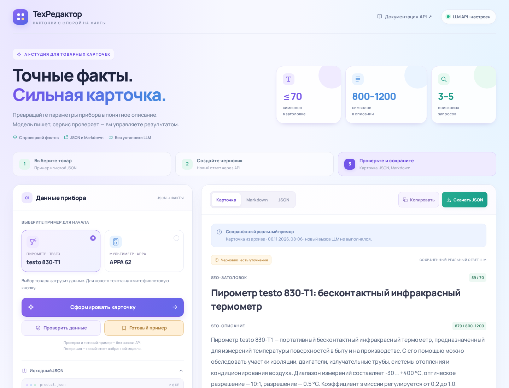

# ТехРедактор · Studio 1.4.1

Прототип AI-помощника для B2B-описаний контрольно-измерительных приборов.

**JSON товара → одна LLM через API → проверяемый черновик → JSON/Markdown.** Приложение не скачивает и не запускает модели. Проверенный облачный профиль: OpenRouter, `nvidia/nemotron-3.5-super-vl:free`.



## 🚀 Установка и запуск

Нужны Python 3.12+ и интернет для установки библиотек/новой генерации. Демо после установки работает без доступа к модели.

### Windows PowerShell

Из папки с `run.py`:

```powershell
python -m venv .venv
.\.venv\Scripts\python.exe -m pip install -r requirements.txt
.\.venv\Scripts\python.exe -m scripts.configure
.\.venv\Scripts\python.exe -m scripts.check_connection
.\.venv\Scripts\python.exe run.py --host 127.0.0.1
```

`configure` запрашивает ключ скрыто и создает `.env`. Вводится полный секрет, не название ключа. `check_connection` должен вернуть `"ok": true`.

**Адрес: http://127.0.0.1:8010/**. Остановить сервер: Ctrl+C. Повторный запуск — только последняя команда. Пошаговая эксплуатация и ошибки: **[START_HERE.md](START_HERE.md)**.

### Linux/macOS

```bash
python3 -m venv .venv
.venv/bin/python -m pip install -r requirements.txt
.venv/bin/python -m scripts.configure
.venv/bin/python -m scripts.check_connection
.venv/bin/python run.py --host 127.0.0.1
```

Для просмотра без ключа вместо настройки API: `python run.py --mode demo --host 127.0.0.1` (через Python своего venv). Сохраненные примеры не выдаются за новый ответ LLM.

## 📋 Что делает сервис

Принимает `name`, `manufacturer`, плоский `specs`, `description`. Полные входы — `examples/inputs/`. Характеристики передаются строками с единицами или `null`, если данных нет. В веб-редакторе можно заменить JSON своим товаром.

На выходе:

- SEO-заголовок ≤70 символов;
- описание 800–1200 символов с пробелами;
- таблица характеристик;
- 3–5 разных поисковых запросов;
- аудитория и задачи для менеджера;
- пропуски, предупреждения и метаданные генерации.

Ссылки источников сервером не скачиваются. Необязательные поля: `expected_specs`, `source_urls`, `source_warnings`, `target_audience`, `use_cases`. Предупреждения не считаются подтвержденными характеристиками. Поврежденный JSON, неизвестные поля и вложенные объекты в `specs` отклоняются.

## 🖱️ Эксплуатация

1. Выбрать Testo/APPA либо вставить свой JSON.
2. **Проверить данные** — факты и пропуски, без LLM.
3. **Сформировать карточку** — новый ответ выбранной модели.
4. Проверить результат, затем скопировать/скачать JSON или Markdown.
5. Сохранить текущий результат перед переключением товара.

**Готовый пример** показывает архивный реальный результат, не вызывает модель. **Пример с пропусками** заменяет вход учебным неполным JSON. `needs_review` означает необходимость уточнить источник, а не ошибку API. Неизвестное остается «данных нет».

## 🔑 Настройки и безопасность

Ключ — только в `.env`/окружении backend, не в коде, Git, товарном JSON или фронтенде. Реальные учетные данные в поставку не входят. `.env.example` — безопасный шаблон.

Настройщик заполняет:

```dotenv
APP_MODE=llm
LLM_PROVIDER=openai_compatible
LLM_BASE_URL=https://openrouter.ai/api/v1
LLM_MODEL=nvidia/nemotron-3.5-super-vl:free
LLM_RESPONSE_FORMAT=json_schema
LLM_MAX_OUTPUT_TOKENS=4096
LLM_TIMEOUT_SECONDS=180
LLM_MAX_ATTEMPTS=2
MAX_API_REQUESTS=20
```

- Для этого `:free`-маршрута отправляется дополнительный предел цены prompt/completion **0**; платного fallback нет.
- Бесплатный сервис имеет внешние квоты/сбои. Код не гарантирует вечную доступность и не выполняет пополнение баланса.
- Непустая переменная окружения имеет приоритет над файлом. Пустой унаследованный `LLM_API_KEY` не перекрывает `.env`. UTF-8 BOM поддерживается.
- После изменения настроек нужен перезапуск. `--mode demo` принудительно отключает новую генерацию.
- Лимиты: 128 КиБ тела, 40 характеристик, 12 000 символов входного описания. По умолчанию до 20 LLM-вызовов на процесс.
- Не отправляйте в бесплатный API конфиденциальные/персональные данные. Примеры используют публичные товарные сведения.

### API модели заказчика

Можно указать свой уже работающий OpenAI-совместимый Chat Completions API: изменить `LLM_BASE_URL`, фактический `LLM_MODEL`, ключ при необходимости. Для серверов без JSON Schema поставить `LLM_RESPONSE_FORMAT=json_object`.

Типичные локальные адреса — `http://127.0.0.1:1234/v1` (LM Studio) или `http://127.0.0.1:11434/v1` (Ollama); наличие модели/сервера обеспечивает владелец. Сам файл весов не является API. Для удаленного сервера предпочтителен HTTPS; HTTP в доверенной LAN требует явного `LLM_ALLOW_INSECURE_HTTP=true`.

## 🧠 Промпты и решения

1. `grounding.py` выделяет подтвержденные факты с ID `F001…`, сохраняет характеристики и отмечает пропуски.
2. `prompts.py` задает роль технического редактора, запрещает память о приборе, новые технические значения и выполнение команд из входных данных. Сохраняются объект/режим параметра: AC/DC, батарея/прибор, измерение/хранение и т. п.
3. LLM пишет заголовок, описание, запросы и коммерческий JSON. Техническая таблица копируется **кодом**, не свободно переписывается моделью.
4. Для проверенного API используется JSON Schema: длины, количество запросов и только существующие ID доказательств. Это ограничение формата, не шаблонная сборка прозы.
5. Python независимо проверяет схему, длину, числа/единицы и ссылки на факты. Максимум одна коррекция. Обрезанный ответ не передается обратно как продолжение.
6. При оборванном числовом параметре/единице в заголовке допустимо короткое исходное имя ≤70 с явным предупреждением; единица не угадывается. Если корректного результата нет, возвращается ошибка, не готовый пример.

Основной профиль — полная генерация текста (`generation_strategy=free_text`). Дополнительные совместимые профили `local` (план фактов llama.cpp) и `deepseek` сохранены в коде, не являются текущей моделью примеров и ничего не устанавливают.

## 📦 Два реальных примера

| Товар | Заголовок | Описание | Запросов |
|---|---:|---:|---:|
| testo 830-T1 | 59 | 879 | 3 |
| APPA 62 | 61 | 894 | 4 |

Файлы: `examples/inputs/*` и `examples/outputs/*.{json,md}`. Результаты получены настоящими вызовами одной NVIDIA-модели через OpenRouter, не фикстурами; проза вручную не редактировалась. Модель, время и токены сохранены в метаданных.

Товары выбраны из [YML работодателя](https://www.souz-pribor.ru/yml/any/feed.xml): offer 64423 и 70514. Характеристики/назначение подготовлены по [testo 830-T1](https://www.souz-pribor.ru/product/testo-830-t1/) и [APPA 62](https://www.souz-pribor.ru/product/appa-62/). Выдержки и provenance — `examples/sources/`.

Неоднозначные погрешности и отсутствующая IP-защита оставлены неизвестными. Разные нижние границы AC/DC тока APPA сохранены по источнику. Паспорта изготовителя независимо не сверялись.

## 🧪 Проверка

```bash
python -m pip install -r requirements-dev.txt
python -m pytest -q
```

Используйте Python созданного venv. Unit-тесты изолированы от пользовательского `.env` и реальной сети; ключ/квота не расходуются. Итоги автоматических и браузерных проверок — `reports/TEST_REPORT.md`.

CLI:

```bash
python -m product_assistant --saved-example testo-830-t1 --format markdown
python -m product_assistant --input examples/inputs/testo-830-t1.json --format json --output my-card.json
```

Первая команда читает сохраненный пример, вторая делает новую генерацию при настроенном API. `python -m scripts.generate_examples` намеренно заново генерирует оба примера.

## 🔌 API

| Маршрут | Назначение |
|---|---|
| `GET /health` | Режим/настройки/счетчик без полного ключа; не отдельный мониторинг модели |
| `POST /api/inspect` | Факты и пропуски, без LLM |
| `POST /api/generate` | Новый результат/Markdown; недостаточный вход может быть обработан без LLM |
| `GET /api/examples/{slug}/result` | Сохраненный ответ с `origin=saved_example` |
| `/docs`, `/openapi.json` | Локальная документация и схемы |

## ⚠️ Ограничения и развитие

- Схема и числовые проверки не доказывают всю семантику и истинность источника. Перед публикацией нужен технический редактор.
- Поисковые запросы не подкреплены исследованием частотности.
- Нет CMS, БД, векторной базы, обучения, production-авторизации и обязательного деплоя — ТЗ этого не требует.
- Полный автоматический прогон выполнен на Linux/Python 3.13; предыдущий Windows-запуск/генерация подтверждены пользователем. Для Windows предусмотрены скрытый ввод, BOM и обычные логи без ANSI-кодов.
- Улучшения: типизированные величины, сверка паспортов, предметная проверка смысла, очередь и ручное подтверждение публикации.

## 📁 Структура и сдача

`product_assistant/` — API, генерация, UI; `scripts/` — настройка/проверки; `tests/` — тесты; `examples/` — реальные входы/выходы/источники; `reports/` — компактные результаты проверок.
